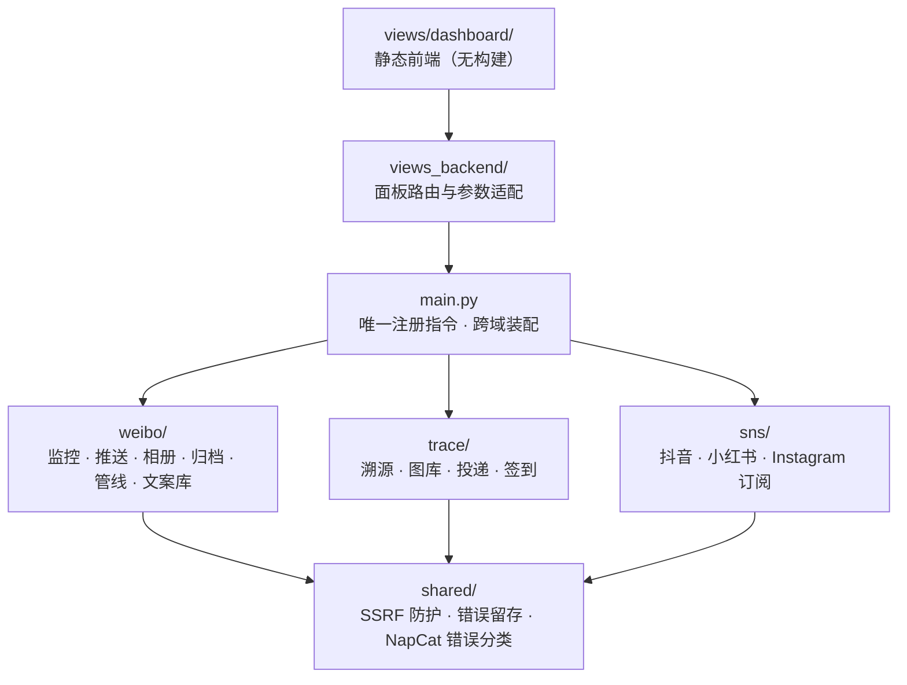
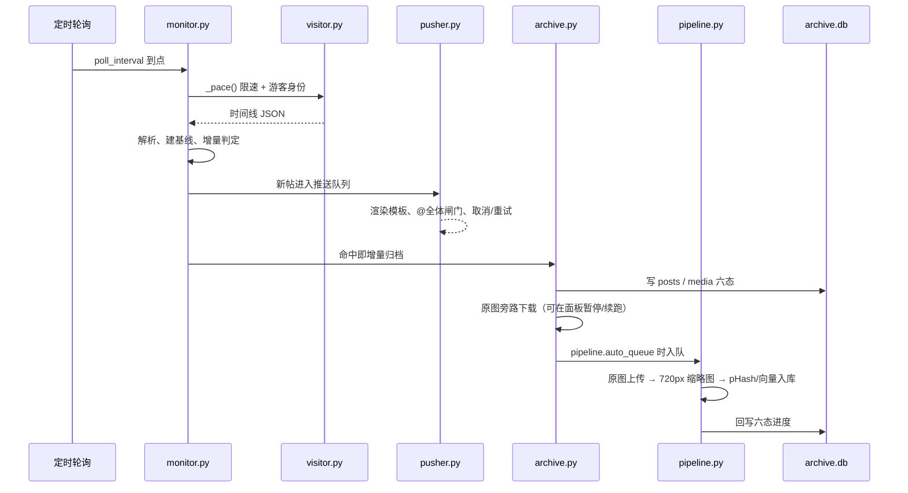

# 架构说明

本文描述 `astrbot_plugin_weibo_suite` 的分层、数据流、生命周期与存储布局。
面向要改代码的人；只想用插件请看 [README](../README.md)，
只想查指令或配置请看 [指令手册](COMMANDS.md) 与 [配置手册](CONFIGURATION.md)。

## 一、为什么是现在这个形状

这个插件把四条本来互不相干的业务线塞进了同一个 AstrBot 插件：

1. **微博监控转发**（免 Cookie 游客身份、推送队列、群相册、视频直发）
2. **微博归档与图床管线**（archive.db 账本、原图下载、图床上传、向量入库）
3. **图片溯源与签到**（pHash/向量双引擎检索、随机图、签到卡片）
4. **多平台订阅**（抖音 / 小红书 / Instagram 的风控友好轮询）

三个硬约束决定了分层：

- **AstrBot 只把入口模块当插件本体。** 加载器按 `handler.__module__ == 插件模块路径`
  绑定处理器，所以 `@filter` 装饰器**只能**出现在 `main.py`。域模块里写装饰器不会被
  绑定，写 `Star` 子类还会被误注册成独立插件。
- **四个域的失败模式完全不同。** 微博域怕风控和丢推送，溯源域怕阻塞事件循环，
  订阅域怕把账号撞进验证码。它们不应该共享一个错误处理策略。
- **拆分必须能随时回到"一个文件"的状态。** 每个域都由 mixin 组成，`main.py`
  用多重继承把它们装成 `WeiboSuitePlugin`。这是有意的：业务逻辑仍是普通方法，
  单测可以直接构造 mixin 实例而不必启动 AstrBot。

## 二、分层与依赖方向



规则（`CONTRIBUTING.md` 里也写了一遍，因为这是最容易破的一条）：

- 依赖方向固定为 `main -> weibo | trace | sns -> shared`。
- **`weibo` 与 `trace` 不互相导入。** 需要跨界时由 `main.py` 注入：
  - 图床管线要图床/向量/图库 → `main._bind_pipeline_services()` 构造
    `PipelineServices` 传给 `weibo/pipeline.py`；
  - 签到要归档正文 → `main._bind_checkin_source()` 把 `copylib_snapshot`
    作为惰性供应器接到 `trace` 域（窄端口：只认 `(指纹, 行列表)`）。
- **`views_backend` 不得反向导入业务实现。** 它只调用入口提供的同语义函数；
  失败时返回非 2xx，不复制业务判断。
- `shared/` 不感知任何业务域，只有 SSRF 防护、受限下载、错误留存这类横向能力。

## 三、域的组成

### 微博域 `weibo/`

| 模块 | 职责 |
| --- | --- |
| `plugin.py` | 域入口 mixin：生命周期、配置迁移、状态落盘 |
| `monitor.py` | 轮询、基线、漏博翻页、帖子解析、增量检测 |
| `api.py` | 微博 API、长文、详情、图片补全、时间线读取 |
| `visitor.py` | 游客身份、请求节流（`_pace`）与风控自愈 |
| `pusher.py` | 推送编排、@全体闸门、取消/重试、视频与富媒体投递 |
| `album.py` | 群相册下载、去重、实况转 GIF、上传 |
| `napcat_album.py` | NapCat OneBot 扩展相册接口客户端 |
| `archive.py` / `archive_db.py` | 归档编排 / 纯同步 SQLite 存储层 |
| `pipeline.py` / `pipeline_naming.py` | 图床→缩略图→向量管线 / 命名模板渲染 |
| `copylib.py` / `cleaner.py` | 文案库编排 / 清洗纯函数 |
| `parser.py` / `runtime.py` | 帖子 JSON 解析纯函数 / 运行时开关（暂停、熔断）快照 |
| `commands.py` / `constants.py` | 微博域指令实现（由 `main.py` 注册） / 域内常量 |

### 订阅域 `sns/`

取数有三条通道，都在 `sns/fetch_m1.py`（浏览器）、`sns/fetch_m2.py`（HTTP Cookie）、
`sns/adapters/rss.py`（RSS 兜底）。平台差异全部收敛在 `sns/adapters/`，上层
`sns/service.py` 只依赖 `SnsPost` 这个共同形状。

风控相关的三个状态必须分清，混用会导致"平台被永久踢出轮询"这类事故：

| 状态 | 语义 | 谁写 | 谁清 |
| --- | --- | --- | --- |
| `platform_paused_until[p]` | 平台熔断的**绝对到期时间戳** | `sns/guard.py` | `service.check_all()` 每轮清理过期项 |
| `account.cooldown_until` | 单账号冷却到期时间戳 | `sns/guard.py` | 时间自然过期 |
| `account.paused` | 需要人工介入（如登录态失效） | `sns/guard.py` | 用户重新登录 |

`sns/scheduler.py` 只做纯函数决策（谁本轮该跑、间隔多少、怎么错峰），
不持有状态、不做 IO，这样排期逻辑可以完整单测。

### 溯源域 `trace/`

`trace/main.py` 只是域入口 mixin（约 640 行，负责装配与指令转发），历史体量早已
按能力拆成若干 mixin：`trace_mixin.py`（溯源检索）、`library_mixin.py`（图库重扫与状态）、
`original_mixin.py`（原图修复/投递）、`delivery_mixin.py`（投递通道选择）、
`qq_upload_mixin.py`（QQ 上传）、`checkin_mixin.py`（签到）、`random_media.py`（随机图）。
其余模块都是可独立测试的纯逻辑或窄客户端：

- `features.py`（pHash/dHash/aHash）、`hash_index.py`、`vector_search.py`、`library.py`：
  检索双引擎与本地图库。
- `image_bed.py`、`s3_store.py`：图床与对象存储客户端。
- `image_delivery.py`、`media_history.py`：投递纯函数与会话级历史。
- `checkin_card.py`、`checkin_store.py`、`weibo_posts.py`：签到。

## 四、一条微博的完整路径



关键设计点：

- **归档是旁路，永远不能反压推送。** 归档下载队列满时丢弃并在面板计数，
  绝不阻塞监控主链。
- **推送与已读解耦。** 只有真正投递成功的 post id 才 `mark_seen`；`_deliver`
  返回 `delivered` 列表，调用方据此标记，避免"推失败也当已读"。
- **归档是原图唯一按需下载方。** 下游读本地副本，失败时按设计回退远端 URL。
- **相册去重以 AstrBot KV 台账为权威**，`archive.db` 的相册状态只供观测。

## 五、生命周期

`main.py` 的 `WeiboSuitePlugin` 装两个子插件实例（溯源域 + 微博域）并实现
`SnsCommandsMixin`。初始化顺序是有讲究的：

```text
initialize()
  1. trace.initialize()        # 先起溯源域
  2. _bind_pipeline_services() # 管线服务必须在微博域启动 worker 之前就位
  3. _bind_checkin_source()    # 文案源是惰性供应器，此时 archive.db 还没打开
  4. super().initialize()      # 微博域：打开 archive.db、起 worker、起面板
  失败 → _rollback_initialize()：按「微博域 → 溯源域」逆序尽力回收，再原样抛出

terminate()
  1. 微博域 terminate()        # 内部先 shutdown 面板后台任务，再 stop pipeline
  2. trace.terminate()
  → 任一步失败都记录汇总，不影响另一步
```

顺序依据：

- **初始化溯源域在前**：它会把共享日志处理器装上，两个域的 warning/error 才进
  同一份错误留存；反过来会丢掉溯源域加载期的告警。
- **卸载时微博域在前**：推送管线持有溯源域注入的 `bed` / `library` 句柄，必须先
  `pipeline_stop()` 再让溯源域关 SQLite 与 HTTP 会话，否则卸载瞬间还在跑的单帖会
  写到已关闭的连接上。所以 terminate 与 initialize 是相反的顺序。
- **失败必须自己回滚**：AstrBot 宿主的 `star_manager` 在 `initialize()` 抛错时只做
  模块级清理，**从不调用** `terminate()`。已建的 errlog 写线程、SQLite 连接、面板
  后台任务、aiohttp 会话若是放任不管，就变成孤儿，重载一次还会叠加一份。所以
  `main.py:85-109` 用 `except BaseException` 兜住、先回收再 `raise`，且回滚不依赖
  `_trace_initialized` / `_weibo_initialized` 标记（失败点可能落在某个域的
  `initialize()` 内部，那个域标记还没置位却已经建了一半资源），两个 `terminate()`
  自身都做到了幂等。

## 六、存储布局

全部落在 `StarTools.get_data_dir("astrbot_plugin_weibo_suite")` 下
（取不到时 `weibo/plugin.py::_resolve_data_dir()` 返回 `None`，`initialize()`
直接抛错——**不会**回落到 `Path(".")`，否则会把运行时数据写进插件源码目录）：

```text
<data_dir>/
├── state.json              # 微博域状态（基线、pending、@全体计数、相册台账指针）
├── archive.db              # 归档账本（SQLite WAL）：posts / media 六态 / 清洗正文
├── archive/<uid>/<mid>/    # 原图与缩略图
├── sns_state.json          # 订阅域状态（账号、冷却、健康度、已读 id）
├── sns/browser/<platform>/ # Playwright 持久化 profile（每个平台一个）
├── copylib/                # 文案导出（正文是真实原创内容，绝不入库）
├── webui_uploads/          # 面板上传的临时文件（6 小时 TTL，最多留 50 个）
└── errors.log              # 错误留存（面板 /errors 读它，返回前统一脱敏）
```

写盘纪律：

- `state.json` / `sns_state.json` 一律「写临时文件 → `os.replace`」，失败要
  **保留 dirty 标记**等下一轮重试，不能先清标记再写。
- `archive.db` 是纯同步 SQLite 存储层，所有调用点必须 `asyncio.to_thread`，
  否则会阻塞事件循环。
- 会话 Cookie 只留在浏览器 profile 里，不落盘、不进日志、不进配置回显。

## 七、跨域横向能力 `shared/`

| 模块 | 能力 |
| --- | --- |
| `shared/http.py` | SSRF 防护：DNS 钉扎、逐跳校验、私网/回环/元数据地址拒绝、受限流式下载 |
| `shared/errorlog.py` | 告警/错误留存与脱敏（URL、查询串凭据、代理账号） |
| `shared/napcat.py` | NapCat/OneBot 错误分类与载荷构造 |
| `shared/common.py` | 小工具与常量 |

**所有外部 URL 下载必须走 `shared/http.py`**，不允许自己 `aiohttp.get`。
媒体下载的额外规则见 `weibo/album.py::_media_pace()`：它用独立的
`MEDIA_REQUEST_GAP`（0.2s）而不是微博 API 的 2–5s `_pace`，因为媒体 CDN 与
API 是两条风控线，套用 API 间隔会把一批 18 张图拖成几分钟。

## 八、面板

`views_backend/` 只做「解析请求 → 调业务 → 返回 JSON」三件事，前端是没有构建
步骤的原生 JS。接口清单、鉴权边界与常见问题见 [docs/WEBUI.md](WEBUI.md)。
面板本身不引入额外鉴权，复用 AstrBot 的会话体系，因此**不要**把面板端点直接
暴露到公网。

## 九、测试策略

- 域模块是普通类/mixin，测试直接构造实例 + 假配置，不需要启动 AstrBot。
- **不 mock 被测逻辑**：SQLite 用真实临时库，HTTP 用本地假客户端，
  浏览器用一个实现相同窄接口的假对象。
- 回归用例都带一句「为什么会有这条」的注释，指向真实故障场景
  （例如 `test_accounts_panel_payload_shape_uses_platform_and_account_id`）。
- `ci.yml` 的门禁：全量 `pytest`、`ruff check`、`ruff format --check`、
  `scripts/build_release.py --check`，外加一个 `real-astrbot` job 装 `AstrBot>=4.28.0,<4.30`
  （与 `metadata.yaml` 的 `astrbot_version` 同一区间，改一处必须同步改另一处），分两步：
  1. `tests/test_real_astrbot.py` —— 干净子进程 `import astrbot`、构造插件、核对
     `error_response` / `json_response` 契约，完全不经过 `conftest`；
  2. 全量套件在 `WEIBO_SUITE_REAL_ASTRBOT=1` 下再跑一遍。
- 两档宿主模式（同一套用例，两种环境）：
  | 环境 | `WEIBO_SUITE_REAL_ASTRBOT` | `sys.modules["astrbot"]` | 用途 |
  | --- | --- | --- | --- |
  | 桩模式（默认） | 不设 | `conftest` 注入的最小桩 | 本机无 AstrBot 也能跑，快 |
  | 真宿主模式 | `1` | 真 `astrbot` 包，只补桩里缺的符号 | 验证真实 Star/组件/filter 语义 |
- **写用例的硬规矩**：不得依赖桩才有的行为（例如桩的 `Image.convert_to_file_path` 会
  凭空造文件、桩的 `resolve_public_addrs` 会跳过 SSRF 白名单），否则该用例在真宿主下
  必红。跨模式差异一律走 `tests/host_compat.py`（`chain_segments` / `image_ref` /
  `command_name_of` / `real_host`），不要自己 `hasattr` 分支。
- 造图片一律用 `Image.fromFileSystem` 或 `Image(file=..., url=...)`：真包的
  `Image.fromURL` 会**真的发网络请求**（假 URL 直接 400），用它等于在测宿主的网络。
- 本机没装 AstrBot 时 `test_real_astrbot` 会 skip；`REAL_ASTRBOT_REQUIRED=1` 时禁止
  skip（缺 astrbot 直接失败）。CI 两步都设了该变量。
- 凡是「框架 API 用法」的回归（如 `error_response(status_code=...)` 是 keyword-only）
  由三层兜：真宿主冒烟、静态门禁 `tests/test_error_response_contract.py`、以及
  真宿主模式下的全量套件。只跑桩模式时这些**一定是绿的**，别据此判断兼容性。

## 十、已知取舍

| 取舍 | 原因 |
| --- | --- |
| `trace/` 拆成 20+ 个 mixin/子模块 | 单文件曾到 4800 行，按能力拆开后 `main.py` 只剩装配；mixin 之间仍有隐式共享状态（`self.library` / `self.bed`），新增能力应放到独立子模块并显式传依赖 |
| 订阅域延迟偏高（抖音 P50 约 150s） | 保号优先。激进档可在面板打开，文档里如实标注代价 |
| 面板无插件级鉴权 | 复用 AstrBot 会话；加 token 会与 WebUI 的单点登录冲突 |
| 归档下载串行 | 并发会显著提高被限流概率，默认 1，可在配置里调 |
| 配置里保留了 59 条旧布局兼容键 | 老版本把配置平铺在顶层，迁移需要它们；详见 [配置手册](CONFIGURATION.md) |
